# Data Analysis — 7 сэдвийн датасетийн шинжилгээ

**Интерактив дашборд: https://sainbayar-data-analysis.vercel.app** (`site/` хавтас, `main` салбарт push хийх бүрт Vercel автоматаар шинэчилнэ.)

`Dataset/` хавтас дахь 8 CSV файлыг (7 сэдэв) Python (pandas, matplotlib, seaborn)-ээр шинжилсэн.
Бүх тоо, графикийг [`analysis/analyze.py`](analysis/analyze.py) скрипт гаргадаг. Тоон дүнгүүд [`reports/summary.json`](reports/summary.json)-д, графикууд [`reports/figures/`](reports/figures/)-д байна.

```powershell
pip install pandas matplotlib seaborn
python analysis/analyze.py            # графикууд + reports/summary.json
python analysis/export_dashboard.py   # дашбордын нэгтгэсэн JSON (dashboard/data/)
```

| # | Датасет | Мөр | Сэдэв |
|---|---------|-----|-------|
| 1 | `Crime_Data_from_2020_to_Present.csv` | 1,004,991 | Лос Анжелес хотын гэмт хэрэг (LAPD) |
| 2 | `Lottery_Powerball_Winning_Numbers__Beginning_2010.csv` | 1,891 | АНУ-ын Powerball сугалааны дугаарууд |
| 3 | `Occupancy_Estimation.csv` | 10,129 | Мэдрэгчээр өрөөний хүний тоо тооцох |
| 4 | `Sensor_data.csv` | 26,387 | Нэг мэдрэгчийн 5 минут тутмын хэмжилт |
| 5 | `unegui.mn_dataset.csv`, `data_2.csv` | 27,861 / 10,582 | Улаанбаатарын орон сууцны зар (unegui.mn) |
| 6 | `japanese_universities.csv` | 813 | Японы их, дээд сургуулиуд |
| 7 | `salaries_by_college_major.csv` | 50 | АНУ-д мэргэжлээр төгсөгчдийн цалин |

> `Crime_Data_from_2020_to_Present.csv` нь 255 MB тул GitHub-ийн 100 MB-ын хязгаараас хэтэрдэг; repo-д оруулаагүй.
> Эх сурвалж: [data.lacity.org](https://data.lacity.org/Public-Safety/Crime-Data-from-2020-to-Present/2nrs-mtv8) — татаж аваад `Dataset/`-д хийвэл скрипт ажиллана.

---

## 1. Лос Анжелесийн гэмт хэрэг (2020-01 – 2025-05)

- **Нийт 1.0 сая хэрэг.** Жилээр: 2020 – 199.8к, 2021 – 209.9к, 2022 – 235.3к, 2023 – 232.3к.
- ⚠️ **2024 оноос огцом унасан нь бодит бууралт биш.** LAPD 2024 онд шинэ бүртгэлийн систем (NIBRS) рүү шилжсэн тул энэ датасетэд шинэ хэрэг бүрэн орохоо больсон. 2024–2025 оны тоог чиг хандлагад ашиглахгүй байх хэрэгтэй.
- **Хамгийн түгээмэл:** машин хулгай (115к), энгийн халдлага (75к), машинаас хулгай (64к), хувийн мэдээлэл хулгайлах (63к), эд хөрөнгө эвдэх (61к).
- **Бүсээр:** Central (69.7к), 77th Street (61.8к), Pacific (59.5к) хамгийн их.
- **Газар:** гудамж (26%), хувийн байшин (16%), орон сууц (12%).
- **Цаг:** 12:00 цаг хамгийн өндөр (бүх хэргийн 6.7%) — гэхдээ энэ нь цаг нь тодорхойгүй хэргийг 12:00 гэж бүртгэдэгтэй холбоотой байж магадгүй.
- **Хохирогч:** медиан нас 37; эрэгтэй 47%, эмэгтэй 42%. Хэргийн 27%-д нас 0 эсвэл хоосон (байгууллага, машин хулгай гэх мэт).
- **Мөрдөлтийн байдал:** 80% нь "Investigation continued", насанд хүрэгчийг баривчилсан нь ердөө 8.7%.

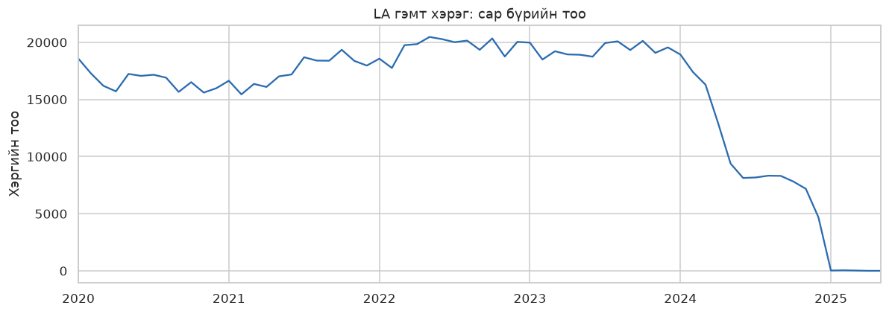
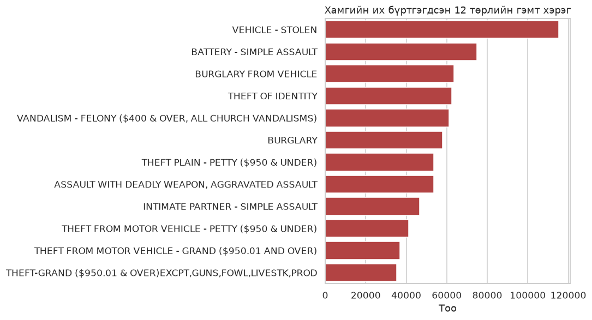
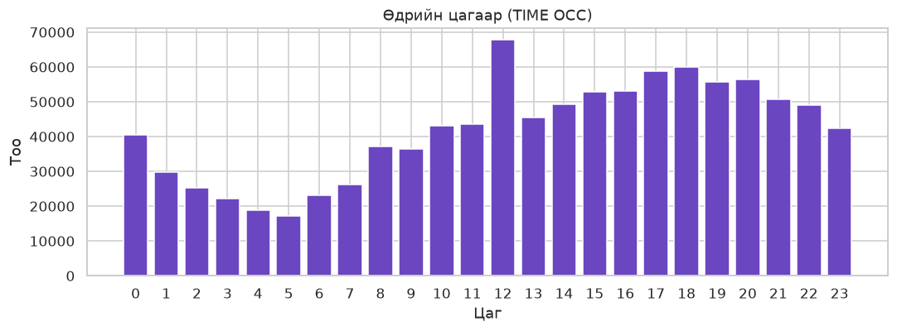

## 2. Powerball сугалаа (2010-02 – 2026-01)

- 1,891 тохирол. 2015-10-07-оос дүрэм өөрчлөгдсөн (цагаан 1–69, улаан 1–26) тул давтамжийг зөвхөн тэр үеэс хойших **1,300** тохирлоор тооцсон.
- "Халуун" цагаан дугаар: **61** (117 удаа), 21, 28, 23, 69. "Хүйтэн": **13** (70), 26, 49.
- **Гэхдээ энэ нь санамсаргүй хэлбэлзэл.** χ² тест: цагаан бөмбөг χ²=80.2 (df=68, 0.05 босго ≈ 88.3), Powerball χ²=22.2 (df=25, босго ≈ 37.7) — аль аль нь **тэгш тархалтаас статистикийн хувьд ялгаагүй**. Өмнө нь их гарсан дугаар дахин гарах магадлал өндөр биш.
- Multiplier: 2× хамгийн түгээмэл (878), 10× ердөө 19 удаа.

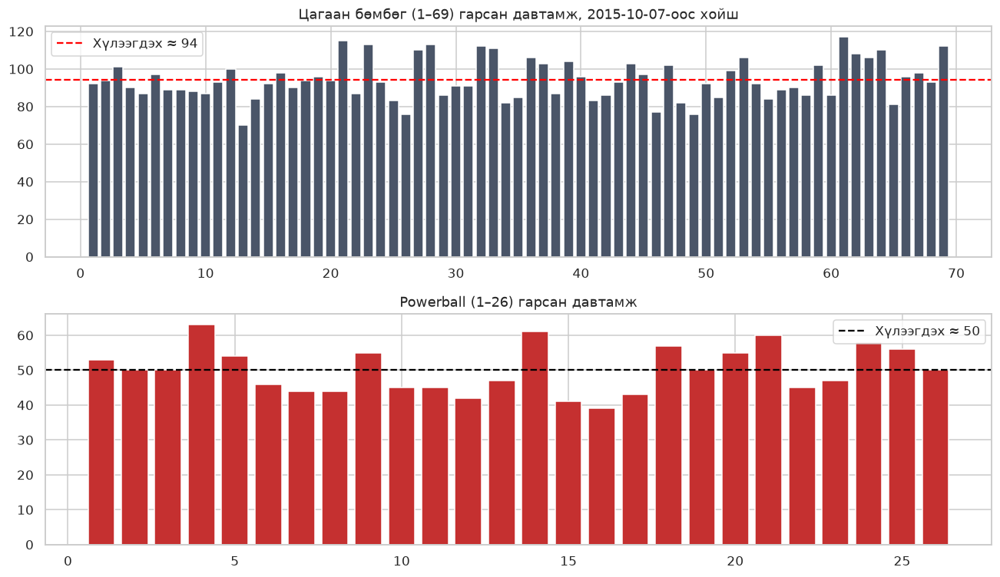

## 3. Өрөөний хүний тоо (Occupancy Estimation)

- 7 өдрийн (2017-12 / 2018-01) 30 секунд тутмын 10,129 хэмжилт, 0–3 хүн. Өрөө **81% хугацаанд хоосон**.
- Хүний тоотой хамгийн хүчтэй корреляци: **гэрэл S1_Light (0.85)**, S3/S2_Light (0.79), температур S1_Temp (0.70), хөдөлгөөн S7_PIR (0.70).
- **Энгийн дүрэм:** `S1_Light > 20` бол "хүнтэй" гэж үзэхэд **98.2%** зөв таана — ML загваргүйгээр.
- Хүний тоог (1/2/3) ялгахад CO₂ илүү тустай: дундаж 404 → 471 → 713 → 851 ppm. Гэрэл харин 1, 2, 3 хүнд бараг адилхан.

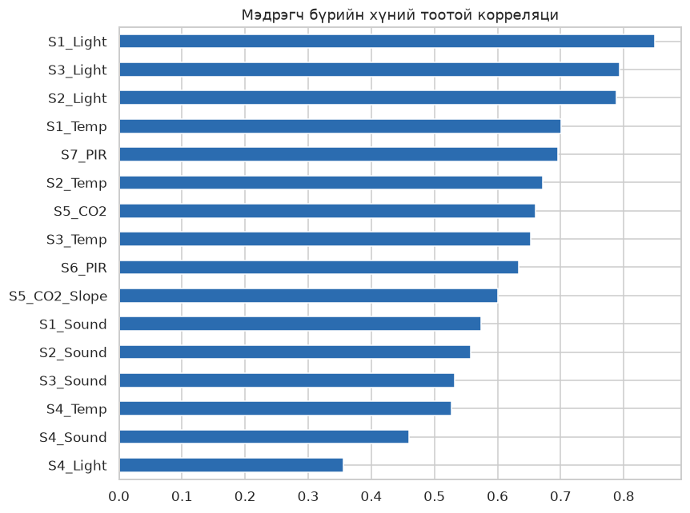
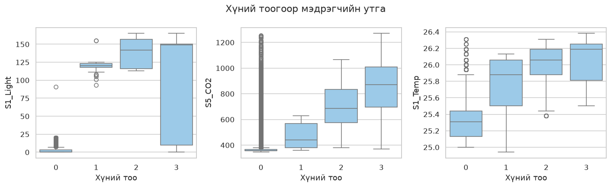

## 4. Мэдрэгчийн цагийн цуваа (Sensor_data)

- 2016-08-18 – 2017-12-18, 5 минут тутам, 26,387 хэмжилт. Утга 50–100 хооронд; медиан 55.
- **Утгын 43% яг 50** — энэ нь мэдрэгчийн доод хязгаар (floor) бололтой.
- **Өгөгдөл тасалдалтай:** 488 хоногийн 366-д нь л өгөгдөл байгаа, 1 цагаас урт 112 тасалдал, хамгийн урт нь **44 хоног**.
- Өдрийн мөчлөгтэй: 09 цагт оргилдоо, 00 цагт хамгийн бага — хүний үйл ажиллагаатай холбоотой хэмжигдэхүүн (жишээ нь чимээ, CO₂ г.м.) байж магадгүй.

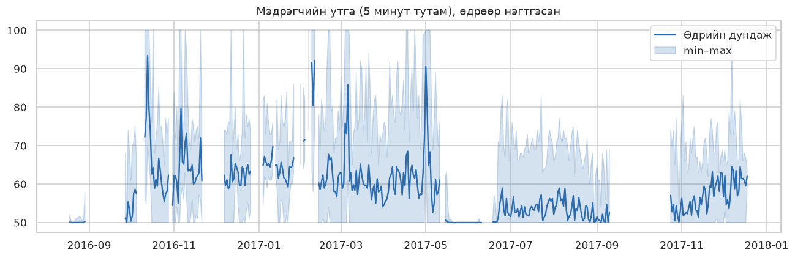
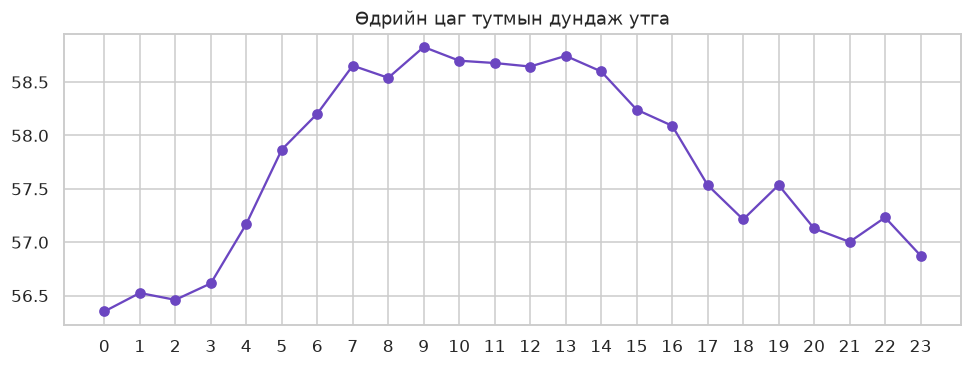

## 5. Улаанбаатарын орон сууцны зар (unegui.mn, 2019-12 – 2021-01)

`data_2.csv` (цэвэрлэсэн хувилбар)-аас 10,454 зар (УБ-ын үндсэн дүүргүүд, 10–200 м²).

- **Медиан үнэ 60 сая ₮**, медиан талбай 34.8 м², **1 м² медиан 1.71 сая ₮**.
- **Дүүргээр 1 м²:** Чингэлтэй 2.06 сая > Сүхбаатар 1.90 > Хан-Уул 1.79 > Баянгол 1.77 > Баянзүрх 1.65 > Сонгинохайрхан 1.51 > Налайх 1.23.
- **Хамгийн үнэтэй байршил:** 40, 50 мянгат (2.5 сая/м²), Төмөр зам (2.17), Баянмонгол (2.11), Олимп хотхон (2.10).
- Үнэд хамгийн их нөлөөлөгч нь **талбай** (r=0.72), дараа нь цонхны тоо (0.39). Ашиглалтанд орсон он бараг нөлөөгүй (r=0.02) — хуучин төвийн байр ба шинэ захын байр хоорондоо тэнцэж байна.
- Лизингтэй/лизинггүй үнийн ялгаа бага (1.75 vs 1.71 сая/м²).
- Зарыг медиан 215 удаа үзсэн.

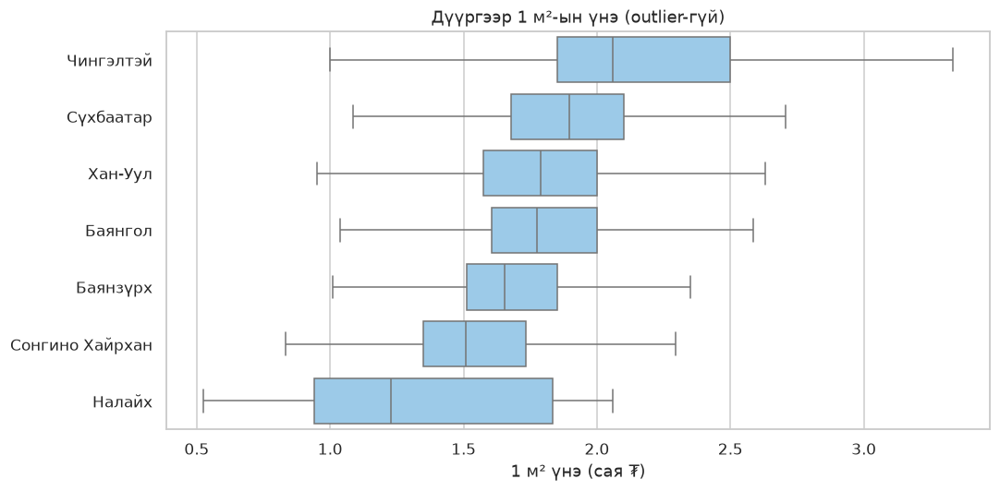
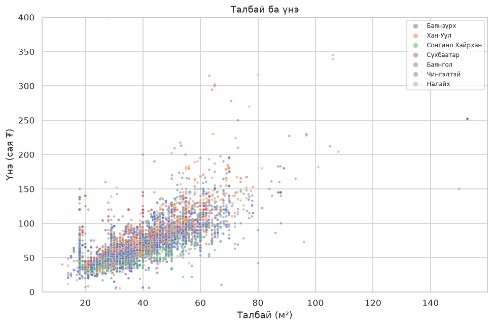
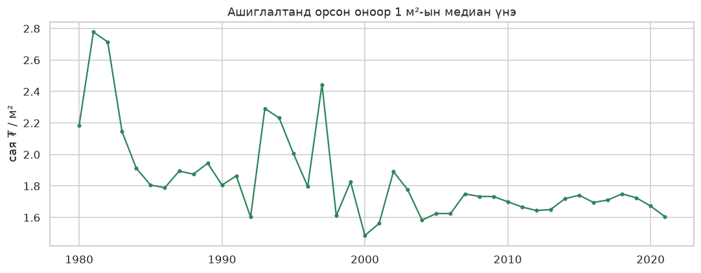

## 6. Японы их, дээд сургуулиуд

- 813 сургууль: хувийн 626 (77%), орон нутгийн 101, үндэсний 86. **Токио** дангаараа 146 (18%).
- Элсэлтийн хүндрэл (hensachi медиан): үндэсний 51.7, орон нутгийн 50.0, **хувийн 38.5**.
- Хүндрэл ба оюутны үнэлгээ эерэг хамааралтай (r=0.41) — хэцүү сургуулийг оюутнууд илүү өндөр үнэлдэг.
- Хамгийн хэцүү: Токиогийн их сургууль (70.5), Nippon Medical School (70.0), Akita International (69.7), ICU (68.0), Hitotsubashi (67.9).
- 77% нь 1945 оноос хойш байгуулагдсан; 81% нь магистр/докторын хөтөлбөртэй.

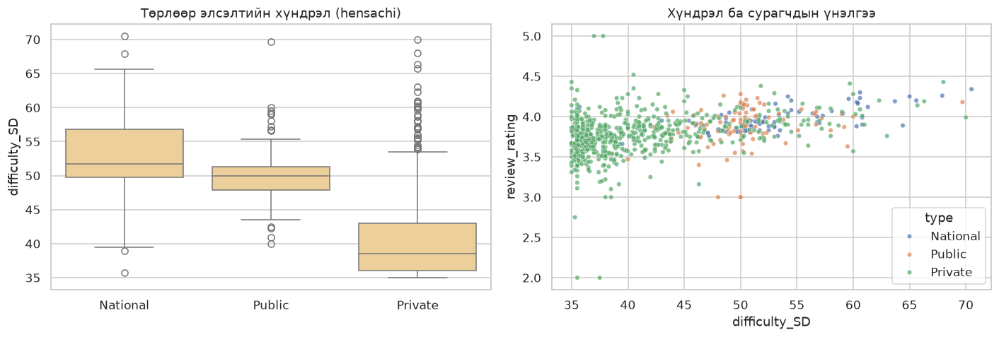
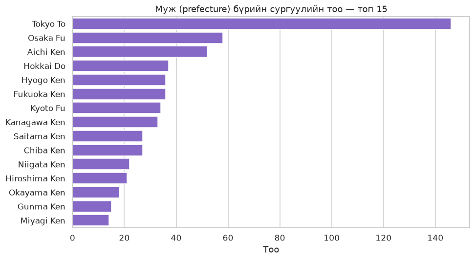

## 7. Мэргэжлээр цалин (АНУ)

- **Эхлэх цалин хамгийн өндөр:** Physician Assistant ($74.3к), Химийн инженер ($63.2к), Компьютерийн инженер ($61.4к).
- **Карьерын дунд үед хамгийн өндөр:** Химийн инженер ($107к), Компьютерийн инженер ($105к), Цахилгааны инженер ($103к).
- **Хамгийн их өсөлт:** Математик, Философи (+104%), Олон улсын харилцаа (+98%), Эдийн засаг (+97%).
- **Тархалт хамгийн өргөн:** Эдийн засаг (10–90 хувь хоорондын зөрүү $159к) — өндөр боломж, гэхдээ эрсдэлтэй.
- Бүлгээр медиан: STEM $93.0к > Бизнес $74.5к > Хүмүүнлэг/нийгэм $61.0к.

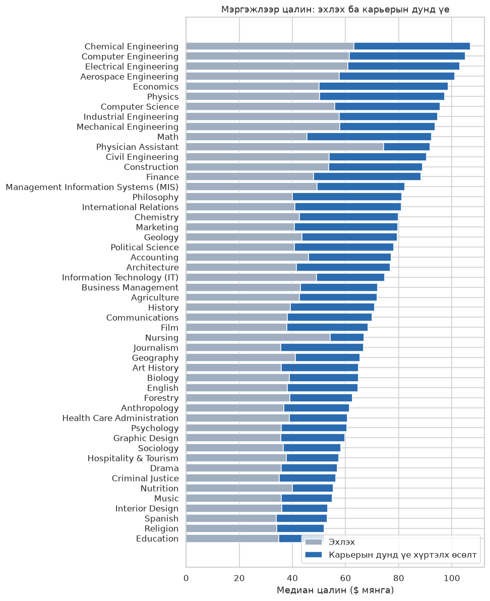
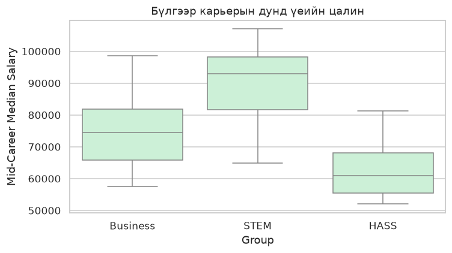
